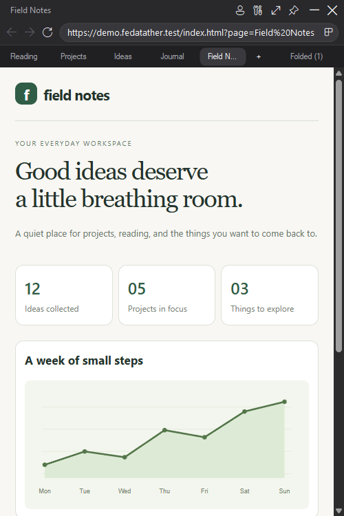
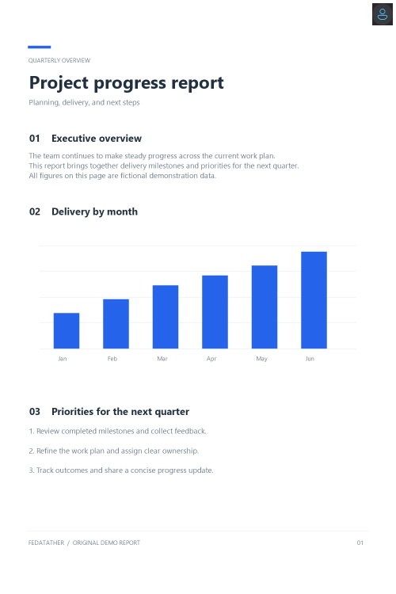
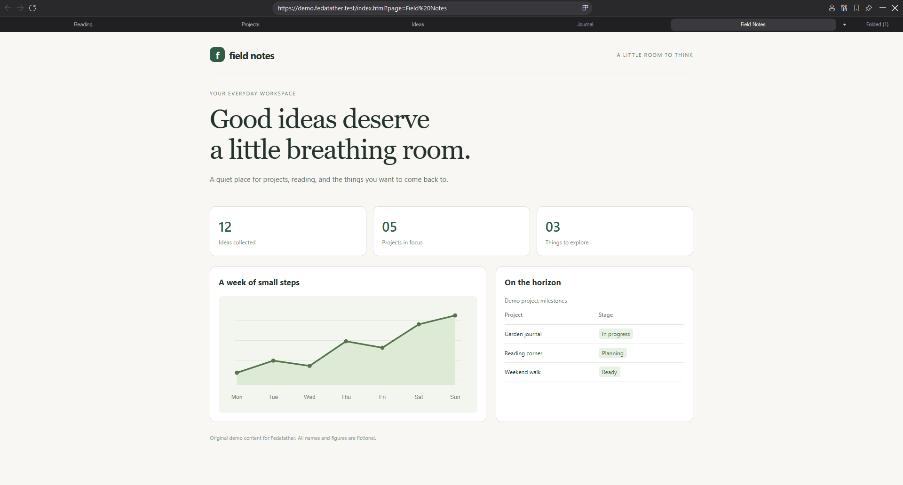
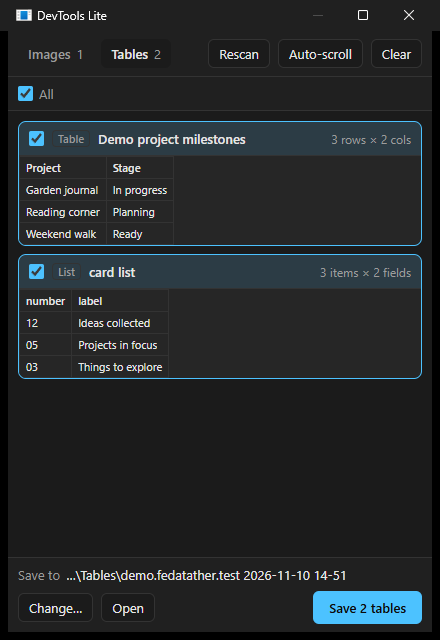

<p align="center"></p>

<h1 align="center">Fedatather</h1>

<p align="center">A featherweight Windows browser: about 1.2 MiB, two window sizes, pin on top, sites saved as apps, and a one-click image and table grabber.</p>

---

Fedatather is built on the Microsoft Edge WebView2 engine that already ships with Windows 10 and 11. There's no bundled Chromium and no installer: the exe and two small WebView2 DLLs make up the app, accompanied by license notices.

## Features

- **Two sizes only:** a phone-sized window (500 × 750 screen pixels) or full screen. Sites always get the normal desktop request; only the window size changes.
- **Five live tabs:** keeps the five most recently opened tabs. Opening a sixth automatically folds the oldest into a local, restorable list and releases its page view.
- **Boss mode:** the human icon hides the browser behind an original demo report. An optional local `assets/boss_here.jpg` overrides it for personal builds. Click it again to restore your tabs, or use Ctrl+Shift+B. The image is embedded in the executable.
- **Pin on top:** keeps the window above everything else.
- **Drag anywhere:** in phone size the toolbar has two rows, and the top row (page title and window buttons) is a large drag handle.
- **Save as web app:** turns the current site into its own Desktop or Start-menu app with the site's icon. It can be fixed to phone size or full screen, and can start pinned.
- **DevTools Lite:** lists the images the page has loaded and the data tables in it. Tick what you want and save it all to a remembered folder in one click. Images keep their original format; tables are saved as CSV.

## Screenshots

Actual Windows app captures using an isolated profile and original fictional demo content.

| Five live tabs + automatically folded links | Boss mode |
|---|---|
|  |  |

<details>
<summary>Full-screen browser and DevTools Lite</summary>





</details>

## Requirements

- Windows 10 or 11 (x64)
- Microsoft Edge WebView2 Runtime (preinstalled on Windows 11; on Windows 10 the app offers the download link)

## Build

```powershell
powershell -ExecutionPolicy Bypass -File .\build.ps1
```

This produces `dist\Fedatather.exe`, `Microsoft.Web.WebView2.Core.dll` and `WebView2Loader.dll`. Keep these files and the accompanying license notices together. No SDK is needed: the script uses the .NET Framework C# compiler built into Windows, downloads the WebView2 SDK from nuget.org on the first build, and renders the app icon from [`assets/fedatather.svg`](assets/fedatather.svg).

For a distributable public build, use `powershell -ExecutionPolicy Bypass -File .\build.ps1 -PublicRelease`. It always uses the original public Boss image, even if a private override exists locally.

Close any running copy before rebuilding, because Windows locks the files in `dist\` while the app runs.

Run the tab integration checks after building with `powershell -ExecutionPolicy Bypass -File .\tests\run.ps1`. These use real WebView2 views and local test pages in an isolated temporary profile.

## Usage

Run `dist\Fedatather.exe`, or pass a URL: `Fedatather.exe https://example.com`.

| Action | Button | Shortcut |
|---|---|---|
| Phone ↔ full screen | size button, or double-click the toolbar | F11 |
| Pin on top | pin | Ctrl+Shift+P |
| Boss mode / restore browser | human icon | Ctrl+Shift+B |
| DevTools Lite (images & tables) | tools icon | F12 |
| Full Edge DevTools | | Ctrl+Shift+I |
| Save site as web app | icon at the right end of the address bar | Ctrl+D |
| Address bar | | Ctrl+L, Alt+D, F6 |
| Back / forward / reload | ← → ⟳ | Alt+←, Alt+→, F5 |
| New tab | + | Ctrl+T |
| Next / previous tab | click a tab | Ctrl+Tab / Ctrl+Shift+Tab |
| Restore folded tab | Folded (count), then choose a page | |
| Close tab | middle-click or right-click a tab | Ctrl+W |
| Close window | ✕ | Alt+F4 |

A page's own fullscreen mode (for example a video) hides the toolbar. Press Esc to leave it.

### Tabs and automatic folding

Up to five tabs stay loaded at once. Opening another tab (including ordinary links that request a new window) saves the oldest tab's title and URL under **Folded (count)**, closes its page view to release resources, and keeps the five newest tabs open. Switching tabs or navigating within one does not change opening order.

Choose a folded page to restore it as the newest tab. If five tabs are already open, the oldest folds in turn. Folded links survive browser restarts and stay local; each saved web app has its own list. Restoring reloads the URL, so unsaved forms, scroll position, and page history are not preserved. Closing a tab manually discards it; closing the last tab closes the window. Sized sign-in popups retain their separate popup behavior.

### DevTools Lite

- **Images** lists every image the page has received, including CSS backgrounds and images inside frames, with thumbnails, sizes and types. "Hide small" filters out icons and tracking pixels (anything under 64 px). It reads images from what the page already downloaded, so nothing is fetched again.
- **Tables** lists the data tables on the page (HTML tables and ARIA grids) and any **repeated lists**, such as post feeds, product grids or search results. In a list, each item becomes a row and each repeated field (title, author, count, link, image) becomes a column. Each one is saved as a UTF-8 CSV that opens correctly in Excel. Real tables and the best list are ticked by default.
- **Scans add up.** **Rescan** (F5) appends anything new to what's already collected: new list items become new rows (matched by each item's own link, so nothing is duplicated), and new images are added. This matters for masonry and infinite-scroll feeds such as Xiaohongshu or Pinterest, which remove posts from the page once you scroll past them.
- **Auto-scroll** scrolls the page down about one screen at a time and collects after each step. It stops when you press **Stop** or when the page stops loading anything new.
- **Clear** starts over. Opening a different page also starts over.
- **Save to:** images and tables each have their own remembered folder, so saving is one click. Every collection saves into its own subfolder named after the site and the time collecting started, such as `Pictures\Fedatather\xiaohongshu.com 2026-11-10 12-45\`, so data from different times never mixes. Saving again during the same collection updates its CSVs in place and adds only images not yet saved.

### Web apps

**Save as web app** asks for a name, address and window size:

- **Phone size (fixed)** or **Full screen (fixed)** always opens at that size, with the size switch hidden.
- **Switchable** remembers whichever size you last used.
- **Start pinned on top** opens above other windows every time.

Each app gets its own taskbar button and remembered position, and shares logins with the main browser. Shortcuts point at the exe's current location, so save apps again if you move it.

## Data

Everything is stored per user in `%LOCALAPPDATA%\Fedatather\`:

| Path | Contents |
|---|---|
| `WebView2\` | cookies, cache, logins |
| `settings.ini` | main window state and last page |
| `settings.ini.folded.json` | folded tab titles and URLs |
| `devtools.ini` | DevTools Lite save folders |
| `apps\` | each web app's icon and window state |

By default DevTools Lite saves to `Pictures\Fedatather\<site> <date time>\` and `Documents\Fedatather Tables\<site> <date time>\`.

## Publishing and privacy

See [the publishing guide](docs/PUBLISHING.md) for the reviewed source ZIP, screenshot regeneration, and public binary builds. `.gitignore` excludes local credentials, browser data, saved settings, exports, and the personal Boss image. Publish the clean source snapshot rather than copying the entire workspace or its local checkpoint refs.

Folded tab titles/URLs and preferences are stored locally as plain files. Boss mode hides the interface while pages stay loaded; it is not a security lock. Websites and WebView2 retain their own privacy behavior.

## Project layout

```
src/            C# sources (C# 5, WinForms + WebView2)
assets/         original icon and public Boss image
docs/           demo pages, screenshots, and publishing guide
tools/          screenshot capture, public asset generation, release audit
build.ps1       one-step build: downloads the SDK, renders the icon, compiles
```

## License

[MIT](LICENSE). The WebView2 SDK files that `build.ps1` downloads into `dist\` are Microsoft's and come under their own license. See [third-party notices](THIRD_PARTY_NOTICES.md).
