<p align="center">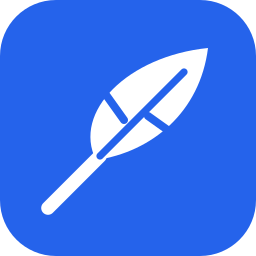</p>

<h1 align="center">Fedatather</h1>

<p align="center">A featherweight Windows browser: about 1.2 MiB, two window sizes, pin on top, sites saved as apps, and a one-click image and table grabber.</p>

---

Fedatather is built on the Microsoft Edge WebView2 engine that already ships with Windows 10 and 11. There's no bundled Chromium and no installer: the exe and two small WebView2 DLLs make up the app, accompanied by license notices.

## Features

- **Two sizes only:** a phone-sized window (500 × 900 screen pixels) or full screen. Sites always get the normal desktop request; only the window size changes.
- **Five live tabs:** keeps the five most recently opened tabs. Opening a sixth automatically folds the oldest into a local, restorable list and releases its page view.
- **Boss mode:** the human icon hides the browser behind an original demo report. An optional local `assets/boss_here.jpg` overrides it for personal builds. Click it again to restore your tabs, or use Ctrl+Shift+B. The image is embedded in the executable.
- **Pin on top:** keeps the window above everything else.
- **Drag anywhere:** in phone size the toolbar has two rows, and the top row (page title and window buttons) is a large drag handle.
- **Save as web app:** turns the current site into its own Desktop or Start-menu app with the site's icon. It can be fixed to phone size or full screen, and can start pinned.
- **DevTools Lite:** lists the images the page has loaded and the data tables in it. Tick what you want and save it all to a remembered folder in one click. Images keep their original format; tables are saved as CSV.
- **Terminal:** the round `>_` button in the bottom-right corner of the page (or Ctrl+`) unfolds PowerShell in a floating window you can move and resize.
- **Translate and ask AI:** select text on a page to get a floating bar: translate it into Chinese with Google Translate, or ask ChatGPT, Claude or Gemini about it.
- **Saved passwords:** import the CSV that Microsoft Edge (or Chrome, Firefox, Bitwarden...) exports, protected by a 6-digit PIN you set once. On sites with a saved login, a key in the address bar fills it in. Manage them in **Settings › Passwords**, laid out like Edge's. The PIN can't be recovered, and 10 wrong PINs in a row erase the saved passwords.
- **Clear browsing data:** **Settings › Privacy** clears cookies and site sign-ins, history, cache and autofill for a chosen time range, or one site's cookies and stored data only.
- **Split screen:** in full screen, three pages side by side in three fixed, equal panes; in phone size, two pages stacked top and bottom. With fewer pages, the remaining panes stay empty until you open something in them. A phone split can be saved as a **dual app** that opens both pages with one click.

## Quick tour

A walk through everyday use, one step at a time. Every picture is a real capture of the app, made by [`tools/CaptureScreenshots.ps1`](tools/CaptureScreenshots.ps1) with a throwaway profile and fictional demo pages. The full details for each step are under [Usage](#usage).

### 1. Browse in the phone-sized window

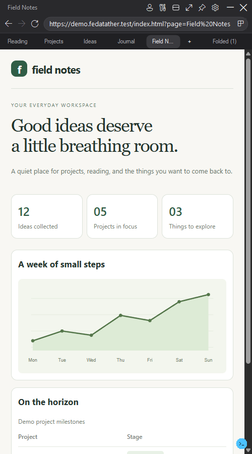

Start `Fedatather.exe`. It opens as a phone-sized window, 500 × 900 pixels.

- **Top row:** the page title, then the buttons, from left to right: **boss mode** (person), **DevTools Lite** (tools), **split screen**, **full screen**, **pin on top**, **settings** (gear), minimize and close. Drag anywhere on the empty part of this row to move the window.
- **Second row:** back, forward, reload and the address bar. Type an address or search words and press Enter. The small icon at the right end of the address bar saves the site as an app (step 4).
- **Tab strip:** up to five live tabs, **+** for a new tab (Ctrl+T), and **Folded (n)**. When you open a sixth tab, the oldest one folds away to save memory. Click **Folded** to bring it back.
- **The small round `>_` button** in the bottom-right corner opens the terminal (step 7).

<br clear="right">

### 2. Switch to full screen

Press **F11**, click the size button, or double-click the toolbar. Fedatather fills the screen with one toolbar row. Press F11 again to go back to the phone window, which returns to where it was.

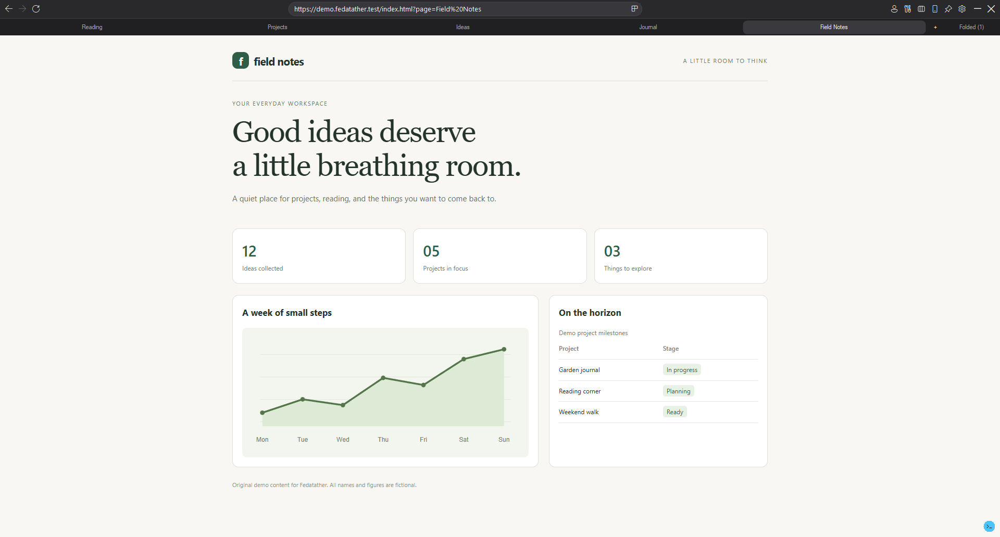

### 3. See two or three pages at once (split screen)

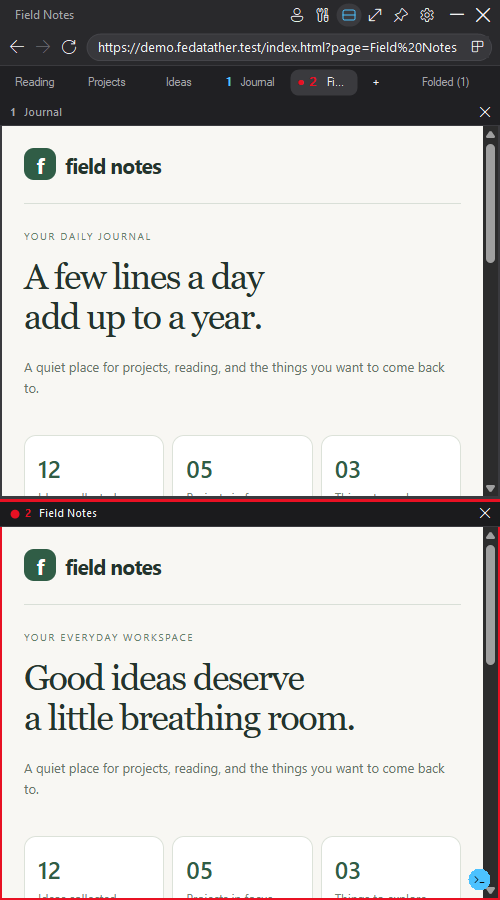

Click the **split screen** button or press **Ctrl+\\**.

- **In the phone window** you get two pages, one above the other (right).
- **In full screen** you get three pages side by side (below).
- The pane with the **red frame** is the current one. The address bar, back, reload and DevTools Lite act on it. Click a pane, or press Ctrl+1, Ctrl+2 or Ctrl+3, to switch.
- A pane's **✕** empties it but keeps its tab open. Fill an empty pane by clicking it and typing an address.
- Press Ctrl+\\ again to go back to one page.

<br clear="right">

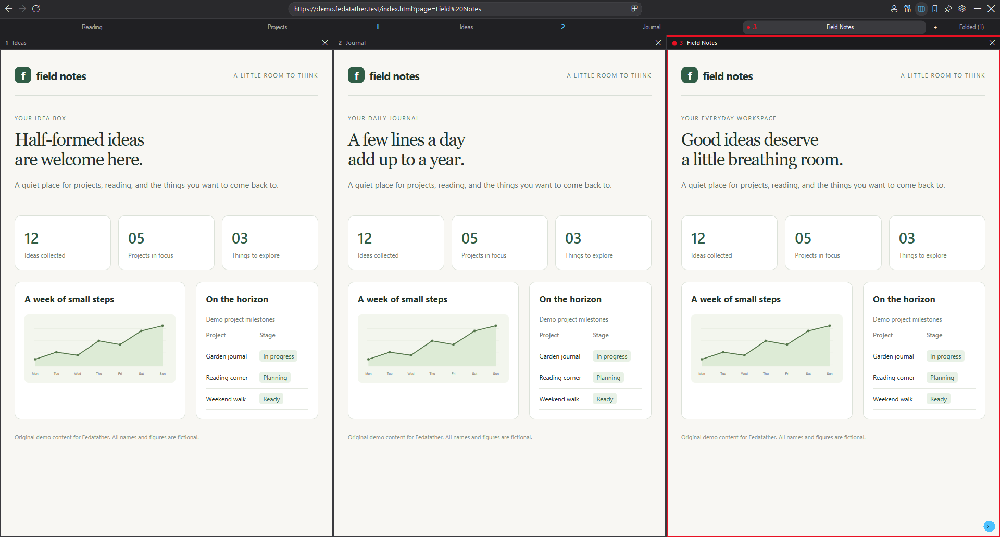

### 4. Save a site as its own app

Click the icon at the right end of the address bar, or press **Ctrl+D**. Give the app a name, choose a window size, and save. You get a Desktop and Start-menu shortcut with the site's icon. The app opens in its own window without the tab strip, and links you click in it open in your normal browser.

| Save as web app | The saved app |
|---|---|
| 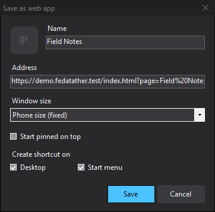 | 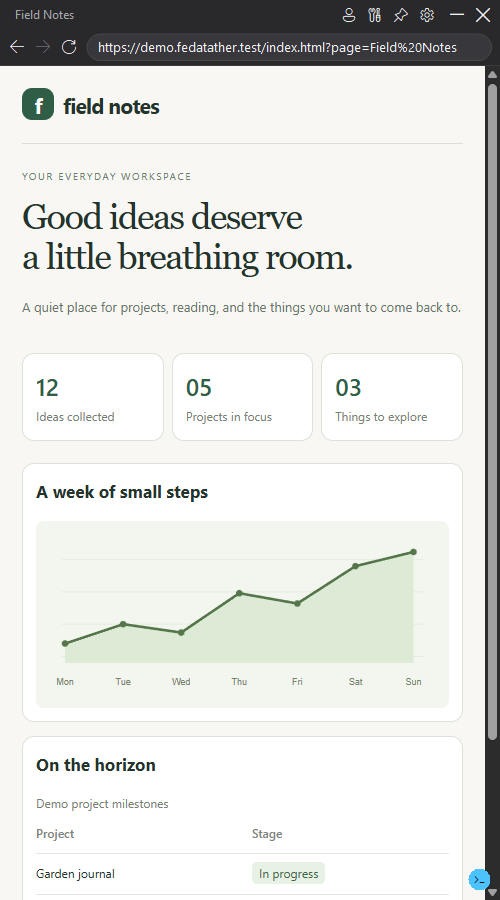 |

### 5. Open two sites with one click (dual app)

In the phone window, turn on split screen with a page in each pane, then press **Ctrl+D**. Keep **Dual app: open both pages, top and bottom** ticked and save. The new shortcut opens both pages together, top and bottom, every time. Closing either page closes the dual app.

| Save as a dual app | The dual app |
|---|---|
| 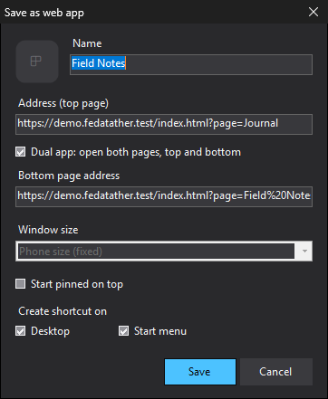 | 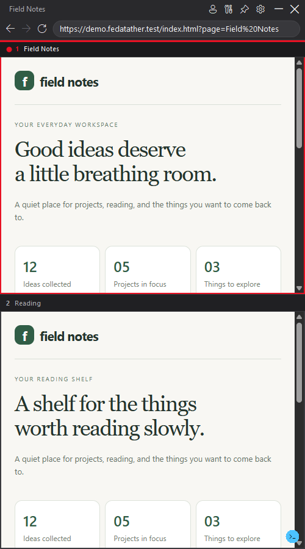 |

### 6. Translate or ask AI about any text

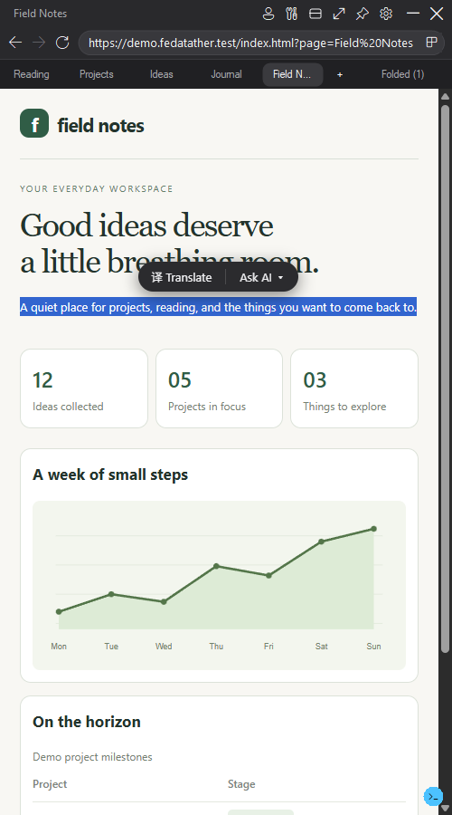

Select text on a page and a small bar appears next to it.

- **译 Translate** opens Google Translate in a new tab, translating the selection into Chinese.
- **Ask AI ▾** lets you pick ChatGPT, Claude or Gemini, which opens in a new tab with your selection as the question.

Click anywhere else or press Esc to hide the bar.

<br clear="right">

### 7. Use the built-in terminal

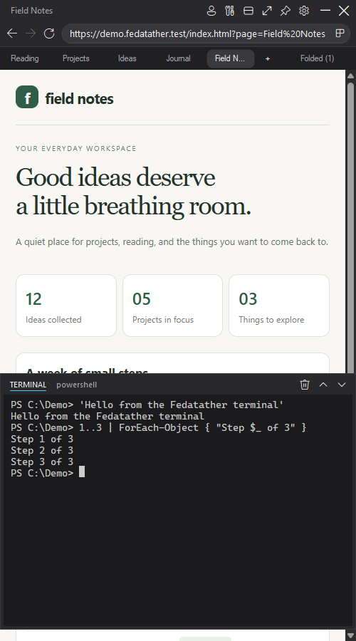

Click the small round **`>_`** button in the bottom-right corner, or press **Ctrl+`**. PowerShell opens in a floating window over the page.

- Drag its header to move it, and drag an edge to resize it.
- **v** (or Ctrl+` again) folds it back into the button. The shell keeps running, so your session is still there next time.
- The trash icon ends the shell.

<br clear="right">

### 8. Save a page's images and tables (DevTools Lite)

Click the **tools** button or press **F12**. DevTools Lite lists the page's images and its tables, including repeated lists such as reviews or product grids, which it turns into tables. Tick what you want and click **Save**: images keep their format and tables are saved as CSV files that open in Excel. **Auto-scroll** keeps scrolling and collecting on long feeds.

| Images | Tables |
|---|---|
| 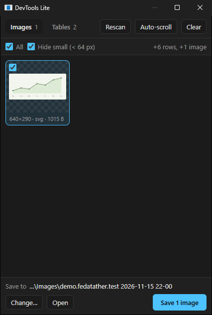 | 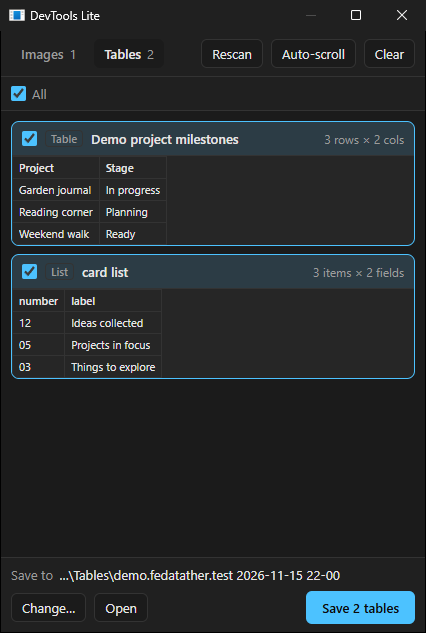 |

### 9. Passwords and privacy (Settings)

Click the **gear** or press **Ctrl+,**.

- **Passwords:** set a 6-digit PIN, then import the passwords file that Edge or Chrome exports. On sites with a saved login, a key appears in the address bar; click it to fill the login in. Write the PIN down: it can't be recovered, and 10 wrong PINs in a row erase the saved passwords.
- **Privacy:** clear cookies and sign-ins, history, cache or form data for a chosen time range, or clear a single site.

| Settings › Passwords | Settings › Privacy |
|---|---|
| 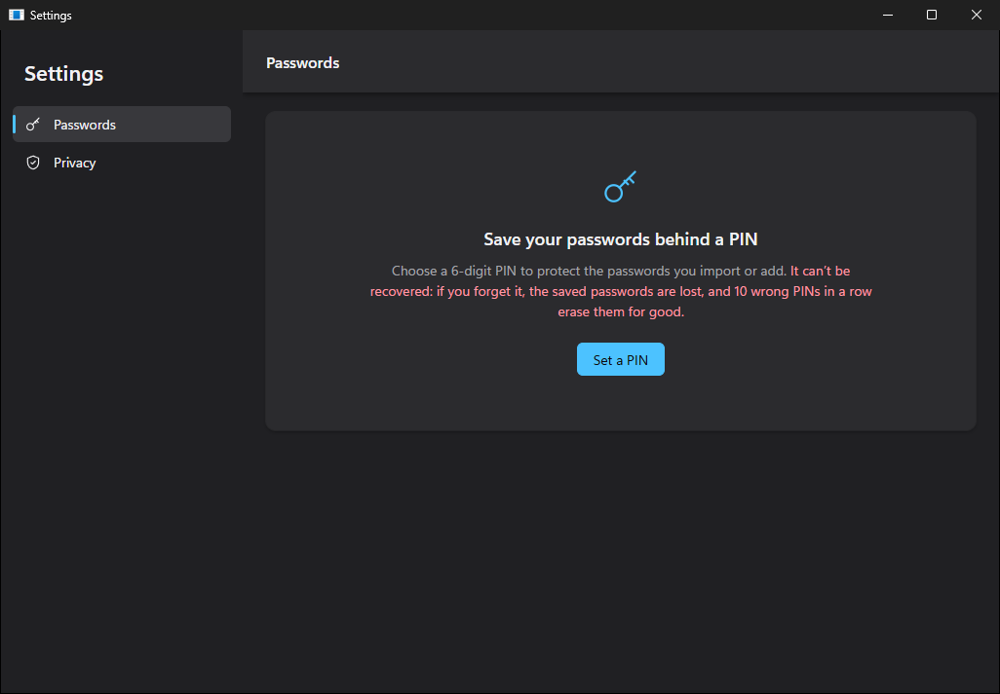 | 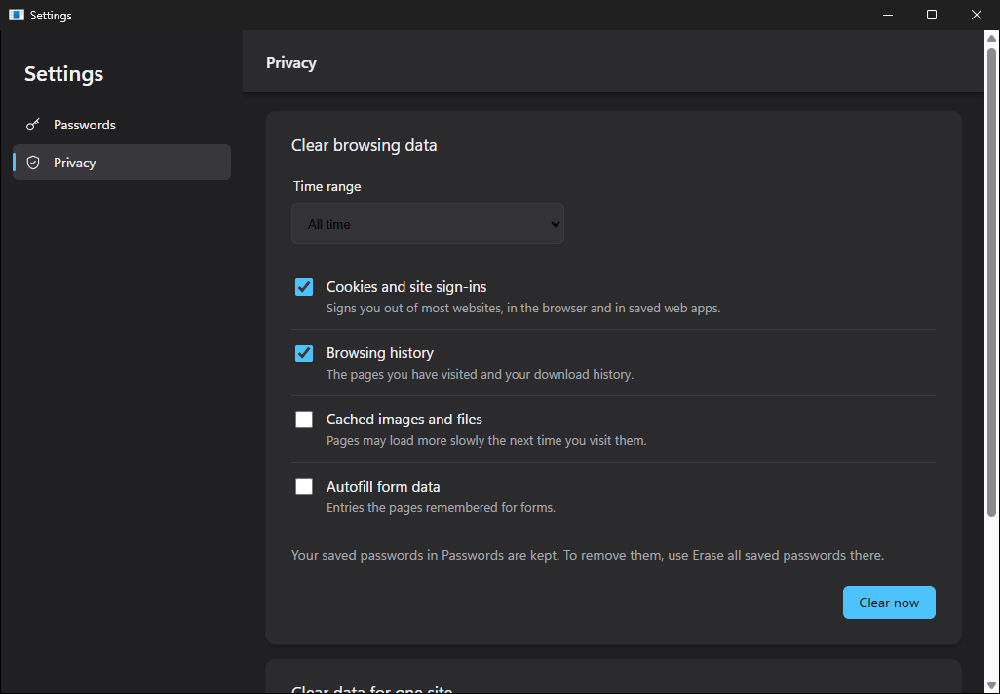 |

### 10. Hide everything in one click (boss mode)

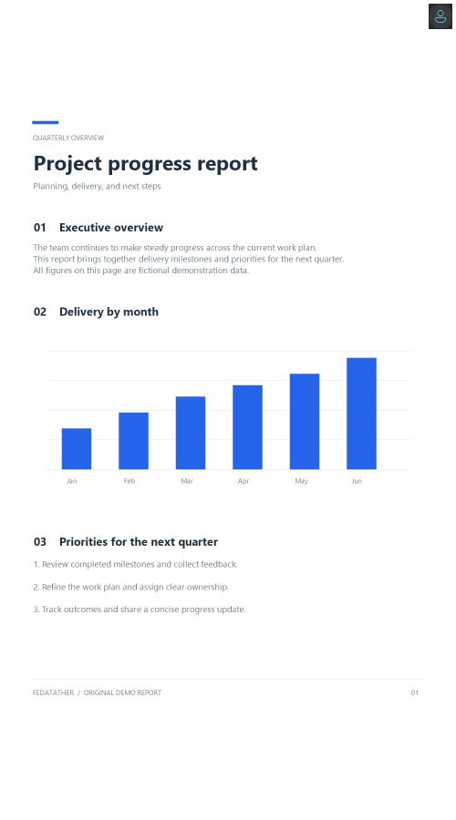

Click the **person** button or press **Ctrl+Shift+B**. The browser, its tabs and the terminal are hidden behind a report page. Saved passwords lock too. Click the button in the top-right corner, or press Ctrl+Shift+B again, to get everything back as it was.

Pin on top (**Ctrl+Shift+P**) keeps the window above all others, which is handy with the phone window.

<br clear="right">

## Requirements

- Windows 10 or 11 (x64)
- Microsoft Edge WebView2 Runtime (preinstalled on Windows 11; on Windows 10 the app offers the download link)
- The terminal needs Windows 10 version 1809 or later

## Getting started from the source ZIP

If you received `Fedatather-source.zip`, it holds the complete source but no ready-made program. Build it once on your own PC; it takes about a minute.

1. **Unblock the ZIP before extracting it.** Windows marks downloaded files as coming from the internet, and PowerShell may then refuse to run the build script. Right-click the ZIP, choose **Properties**, tick **Unblock** and click **OK**. You won't see the box if the file wasn't downloaded.
2. **Extract it** to a folder of your own, for example `Documents\Fedatather`. Everything is inside a `Fedatather` folder.
3. **Open PowerShell in that folder:** open the extracted `Fedatather` folder in File Explorer, click the address bar, type `powershell` and press Enter.
4. **Build:**
   ```powershell
   powershell -ExecutionPolicy Bypass -File .\build.ps1
   ```
   The first build downloads the WebView2 SDK from nuget.org, so you need an internet connection that one time. Nothing else needs installing: the compiler is part of Windows.
5. **Run** `dist\Fedatather.exe`. To keep it, copy the whole `dist` folder wherever you like (keep its files together) and pin `Fedatather.exe` to Start or the taskbar.

Your browsing data, saved passwords and settings live in `%LOCALAPPDATA%\Fedatather\`, not in this folder (see [Data](#data)). To update, extract a newer ZIP and build again: your data stays where it is.

To put the source on GitHub, initialize a new Git repository inside the extracted folder. The ZIP deliberately carries no Git history.

## Build

```powershell
powershell -ExecutionPolicy Bypass -File .\build.ps1
```

This produces `dist\Fedatather.exe`, `Microsoft.Web.WebView2.Core.dll` and `WebView2Loader.dll`. Keep these files and the accompanying license notices together. No SDK is needed: the script uses the .NET Framework C# compiler built into Windows, downloads the WebView2 SDK from nuget.org on the first build, and renders the app icon from [`assets/fedatather.svg`](assets/fedatather.svg). The JavaScript and HTML the app injects into pages (selection bar, DevTools Lite, Settings) live in [`src/scripts/`](src/scripts/) and are built into the exe as UTF-8; the boss image is re-encoded at JPEG quality 75 when that makes it smaller.

For a distributable public build, use `powershell -ExecutionPolicy Bypass -File .\build.ps1 -PublicRelease`. It always uses the original public Boss image, even if a private override exists locally.

Close any running copy before rebuilding, because Windows locks the files in `dist\` while the app runs.

Run the tab integration checks after building with `powershell -ExecutionPolicy Bypass -File .\tests\run.ps1`. These use real WebView2 views and local test pages in an isolated temporary profile.

## Usage

Run `dist\Fedatather.exe`, or pass a URL: `Fedatather.exe https://example.com`.

| Action | Button | Shortcut |
|---|---|---|
| Phone ↔ full screen | size button, or double-click the toolbar | F11 |
| Pin on top | pin | Ctrl+Shift+P |
| Boss mode / restore browser | human icon | Ctrl+Shift+B |
| DevTools Lite (images & tables) | tools icon | F12 |
| Full Edge DevTools | | Ctrl+Shift+I |
| Terminal (PowerShell) | round `>_` button, bottom right | Ctrl+` |
| Split screen on / off (3 columns in full screen, 2 rows in phone size) | split icon | Ctrl+\ |
| Go to split-screen pane 1, 2, 3 | click the pane | Ctrl+1, Ctrl+2, Ctrl+3 |
| Save site as web app | icon at the right end of the address bar | Ctrl+D |
| Fill a saved password (sites with one) | key in the address bar | Ctrl+Shift+K |
| Settings (saved passwords, clear browsing data) | gear | Ctrl+, |
| Address bar | | Ctrl+L, Alt+D, F6 |
| Back / forward / reload | ← → ⟳ | Alt+←, Alt+→, F5 |
| New tab | + | Ctrl+T |
| Next / previous tab | click a tab | Ctrl+Tab / Ctrl+Shift+Tab |
| Restore folded tab | Folded (count), then choose a page | |
| Close tab | middle-click or right-click a tab | Ctrl+W |
| Close window | ✕ | Alt+F4 |

A page's own fullscreen mode (for example a video) hides the toolbar. Press Esc to leave it.

### Tabs and automatic folding

Up to five tabs stay loaded at once. Opening another tab (including ordinary links that request a new window) saves the oldest tab's title and URL under **Folded (count)**, closes its page view to release resources, and keeps the five newest tabs open. Switching tabs or navigating within one does not change opening order.

Choose a folded page to restore it as the newest tab. If five tabs are already open, the oldest folds in turn. Folded links survive browser restarts and stay local. Saved web apps use a single page and have no folded tabs. Restoring reloads the URL, so unsaved forms, scroll position, and page history are not preserved. Closing a tab manually discards it; closing the last tab closes the window. Sized sign-in popups retain their separate popup behavior.

### DevTools Lite

- **Images** lists every image the page has received, including CSS backgrounds and images inside frames, with thumbnails, sizes and types. "Hide small" filters out icons and tracking pixels (anything under 64 px). It reads images from what the page already downloaded, so nothing is fetched again.
- **Tables** lists the data tables on the page (HTML tables and ARIA grids) and any **repeated lists**, such as post feeds, reviews (for example on Google Maps), product grids or search results. In a list, each item becomes a row and each repeated field (name, rating, date, text, link, image) becomes a column. Columns take the page's own field names where it has readable ones, and are otherwise named after what they hold. Each one is saved as a UTF-8 CSV that opens correctly in Excel. Real tables and the best list are ticked by default.
- **Full text:** reviews and posts cut short behind a **More** button are expanded before collecting. Only buttons that expand text in place are pressed, never links or menus.
- **Scans add up.** **Rescan** (F5) appends anything new to what's already collected: new list items become new rows (matched by each item's own id or link, so nothing is duplicated), and new images are added. This matters for masonry and infinite-scroll feeds such as Xiaohongshu or Pinterest, which remove posts from the page once you scroll past them.
- **Auto-scroll** scrolls the page down about one screen at a time and collects after each step. It stops when you press **Stop** or when the page stops loading anything new.
- **Clear** starts over. Opening a different page also starts over.
- **Save to:** images and tables each have their own remembered folder, so saving is one click. Every collection saves into its own subfolder named after the site and the time collecting started, such as `Pictures\Fedatather\xiaohongshu.com 2026-11-10 12-45\`, so data from different times never mixes. Saving again during the same collection updates its CSVs in place and adds only images not yet saved.

> **Collect only what you're allowed to.** Follow each website's terms of service and the law. You alone are responsible for what you collect and how you use it. See the [Disclaimer](#disclaimer).

### Saved passwords

**Importing from Microsoft Edge:** in Edge, open `edge://settings/passwords`, choose **⋯ > Export passwords**, and save the CSV file. In Fedatather, open **Settings** (the gear at the top right, or Ctrl+,) › **Passwords**, then **Import passwords** (or **⋯ › Import passwords (CSV)**). Exports from Chrome, Firefox, Bitwarden, 1Password and similar tools work too. Importing the same file again updates changed passwords without making duplicates.

- **The PIN:** the first time, you choose a 6-digit PIN. It is never stored and **can't be recovered**. Write it down somewhere safe. If you forget it, the saved passwords are lost: **Forgot your PIN?** in the unlock window erases them so you can start over and import again.
- **10 wrong PINs in a row erase the saved passwords for good.** The unlock window shows how many attempts are left. A correct PIN resets the count, and restarting Fedatather doesn't.
- **Filling a login:** on a site with saved logins, a blue key appears in the address bar (it isn't there on other sites). Click it, enter the PIN if asked, and pick the login. Fedatather fills the username and password; you press the site's own sign-in button. A login only fills on its own site and that site's subdomains, never on plain `http://` or on look-alike addresses. Nothing is filled without you picking it.
- **Settings › Passwords** (also **Manage saved passwords…** in the key's menu): sites listed with their icon and number of accounts, as in Edge. Search, **+ Add**, and **⋯** to import, lock or erase everything. Open a site to see a card for each account: copy the account name, open the site, show or copy the password, see the note, **Edit** or **Delete**. A shown password hides itself again after 30 seconds, and a copied one is cleared from the clipboard after 30 seconds. The page only receives a password when you show or edit it.
- **Site icons** are the icons of sites with saved logins, kept when you visit them in Fedatather; other sites get a letter. The page never fetches icons from the internet. Erasing the saved passwords removes the icons too.
- **Locking:** saved passwords lock again after 5 minutes unused, when you click **Lock**, in boss mode, and when Fedatather closes. Each saved web app shares the same saved passwords and unlocks separately.
- **After importing, delete the CSV file.** It holds every password in plain text. Fedatather reminds you and shows where the file is, but doesn't delete it for you.

**How they're protected:** saved passwords are encrypted with a key made from your PIN (PBKDF2-SHA256, AES-256 and HMAC-SHA256), and that again with Windows' own per-user encryption (DPAPI). A copy of the file is useless on another computer or Windows account. The names of the sites you have logins for are covered only by the Windows layer, so the key can light up before you unlock. A 6-digit PIN has only a million possibilities, so it protects against other people using your computer and against a copied file. It does not stand up to malware running under your own Windows account, which could try every PIN offline. Keep your Windows account locked, as you would anyway.

### Clearing cookies, sign-ins and history

**Settings** (the gear, or Ctrl+,) › **Privacy** › **Clear browsing data**: choose a time range (last hour, 24 hours, 7 days, 4 weeks or all time) and what to clear, then **Clear now**.

- **Cookies and site sign-ins:** signs you out of most websites. Cookies and site storage are shared by the browser and every saved web app, so they are signed out too.
- **Browsing history:** visited pages and download history.
- **Cached images and files** and **Autofill form data**.

**One site only:** under **Clear data for one site**, the sites that have cookies are listed, with subdomains grouped under their site (mail.example.com under example.com). **Clear** next to a site, or type a site or address and press **Clear this site** (or Enter), removes that site's cookies and stored data (local storage, IndexedDB, service workers and so on), subdomains included. That signs you out of it and leaves other sites alone. WebView2 can't remove one site's history or cached files on their own; use the time-range clearing above for those.

Your saved passwords (Settings › Passwords) are not touched. Pages already open keep what they have showing until you reload them.

### Split screen

In full screen, the three-column icon (next to the size button) or Ctrl+\ divides the page area into three equal panes side by side. In phone size the same button (a two-row icon) divides it into two equal panes, one above the other; Ctrl+1 and Ctrl+2 pick the top and bottom pane. Switching size leaves split screen. Everything below works the same way in both.

- **Turning it on** shows the current page plus the most recently opened other tabs, in tab-strip order. With only two tabs open, the third pane stays empty.
- **The current pane** is marked in red: a red dot and a red top edge on its header, a red frame around the page, and a red **● n** on its tab. The address bar, back, forward, reload and DevTools Lite act on it. Click anywhere in a pane (the page, its header or an empty pane), or press Ctrl+1, Ctrl+2 or Ctrl+3, to make it current. It follows clicks, not the mouse pointer, so moving the mouse across other pages on the way to the toolbar doesn't change it.
- **DevTools Lite reads the red pane.** Its header says "DevTools Lite reads this page", and the DevTools Lite window title names the pane, for example *DevTools Lite — reading pane 2 ● Projects*. Making another pane current switches DevTools Lite to that page. Each page keeps its own DevTools Lite while split screen is on, so switching back shows what you already collected there, and an auto-scroll keeps running on its page while you look at another. Turning DevTools Lite off (F12, the tools icon, or its window's ✕) closes all of them.
- **Filling an empty pane:** click it and type an address, or use its **New tab** button, or pick one of the open tabs it lists. New tabs, links that open a new tab, and restored folded tabs also go into the current pane if it's empty, and otherwise into the first empty pane. When no pane is empty, they replace the current pane's page, which stays open in the tab strip.
- **Tabs:** tabs on screen show their pane number in the tab strip. Clicking a tab that's already shown selects its pane; clicking one that isn't shown puts it in a pane by the same rule.
- **A pane's ✕** empties that pane. Its tab stays open. Closing a tab (Ctrl+W, middle-click) also leaves its pane empty.
- The five-live-tabs limit still applies. If a shown tab folds, its pane becomes empty. A page that goes fullscreen (a video, for example) temporarily takes the whole page area.

### Terminal

The round `>_` button floating in the bottom-right corner of the page unfolds into a PowerShell terminal in a floating window over the page. It runs PowerShell 7 (`pwsh`) when that's installed and Windows PowerShell otherwise, starting in your user folder. It's a real console session (Windows ConPTY), so colours, tab completion, history and full-screen console programs work.

- **Unfold and fold:** the `>_` button opens the window; the **v** button in its header or Ctrl+` folds it back into the button. Folding keeps the shell running; showing it again brings back the same session. When the page has focus, Ctrl+` moves focus to an open terminal instead of hiding it.
- **Close the shell:** the trash icon, or type `exit`. The next open starts a fresh one.
- **Move and resize:** drag the window's header to move it, or any edge or corner to resize it. The **^** button or a double-click on the header maximizes it over the page. Its size and place are remembered.
- **Keys:** while the terminal has focus, keys go to the shell (Ctrl+L, Ctrl+R, Ctrl+T, Ctrl+W and F5 included). Only Ctrl+`, Ctrl+Tab, F11, F12, Ctrl+Shift+P and Ctrl+Shift+B still act on the browser.
- **Copy and paste:** select with the mouse (double-click selects a word). Ctrl+C copies when text is selected and otherwise interrupts the running command. Ctrl+Shift+C also copies. Ctrl+V, Ctrl+Shift+V or Shift+Insert pastes. Right-click copies the selection, or pastes when nothing is selected.
- **Scrollback:** the mouse wheel or Shift+PageUp / Shift+PageDown scrolls through the last 5,000 lines.
- **Boss mode** hides the terminal along with the browser; the shell keeps running.

### Translate and ask AI

Select text on any page and a small bar appears next to it:

- **译 Translate** opens Google Translate in a new tab, translating the selection into Chinese (up to 5,000 characters).
- **Ask AI ▾** offers **ChatGPT**, **Claude** or **Gemini**; the one you pick opens in a new tab with the selection as the question (up to 4,000 characters). For Gemini the text is also copied to the clipboard, so you can paste it if Gemini doesn't fill it in. You need to be signed in to that AI's site, as usual.

It also works on text selected inside text boxes, but never in password boxes. Clicking elsewhere, Esc or clearing the selection hides the bar. In a saved web app, these open in your default browser.

### Web apps

**Save as web app** asks for a name, address and window size:

- **Phone size (fixed)** or **Full screen (fixed)** always opens at that size, with the size switch hidden.
- **Switchable** remembers whichever size you last used.
- **Start pinned on top** opens above other windows every time.

**Dual apps:** in phone size with split screen on and a page in both panes, **Save as web app** offers *Dual app: open both pages, top and bottom* (ticked by default), with the top and bottom addresses. The shortcut then opens both pages at once in one phone-size window, split top and bottom. A dual app is always phone size; closing either page (Ctrl+W) closes the app.

Saved apps show one page (a dual app two) with no tab strip, new-tab action or split-screen toggle. Clicked web links and popup links open in your default browser, leaving the app on its current page.

Each app gets its own taskbar button and remembered position, and shares logins with the main browser. Shortcuts point at the exe's current location, so save apps again if you move it.

## Data

Everything is stored per user in `%LOCALAPPDATA%\Fedatather\`:

| Path | Contents |
|---|---|
| `WebView2\` | cookies, cache, logins |
| `settings.ini` | main window state, last page and terminal window size and place |
| `settings.ini.folded.json` | folded tab titles and URLs |
| `devtools.ini` | DevTools Lite save folders |
| `passwords.dat` | saved passwords, encrypted with your PIN and Windows DPAPI |
| `site-icons\` | icons of sites with saved logins, for Settings › Passwords |
| `apps\` | each web app's icon and window state |

By default DevTools Lite saves to `Pictures\Fedatather\<site> <date time>\` and `Documents\Fedatather Tables\<site> <date time>\`.

## Publishing and privacy

See [the publishing guide](docs/PUBLISHING.md) for the reviewed source ZIP, screenshot regeneration, and public binary builds. `.gitignore` excludes local credentials, browser data, saved settings, exports, and the personal Boss image. Publish the clean source snapshot rather than copying the entire workspace or its local checkpoint refs.

Folded tab titles/URLs and preferences are stored locally as plain files. Boss mode hides the interface while pages stay loaded; it is not a security lock. Websites and WebView2 retain their own privacy behavior.

## Project layout

```
src/            C# sources (C# 5, WinForms + WebView2)
assets/         original icon and public Boss image
docs/           demo pages, screenshots, and publishing guide
tools/          screenshot capture, public asset generation, release audit
build.ps1       one-step build: downloads the SDK, renders the icon, compiles
```

## Disclaimer

Fedatather, including DevTools Lite, is a general-purpose tool. Its authors and contributors provide the software only. They don't operate, control, monitor or endorse any use of it, and they collect nothing from your computer.

- **You are responsible for how you use it.** Before you collect, save, copy or reuse anything from a website, make sure you're allowed to. That includes following the site's terms of service and acceptable-use rules, respecting its robots.txt and rate limits, and complying with copyright, database rights, and the privacy and data-protection laws (such as the GDPR) that apply to you and to the people whose data you handle.
- **Content belongs to its owners.** Posts, reviews, photos, names and profile pictures belong to the people and companies who published them. Saving them with Fedatather doesn't give you any right to republish, sell, or otherwise use them.
- **No circumvention.** DevTools Lite reads only what a page has already shown you in your own browser session. It's not designed to get past logins, paywalls, CAPTCHAs, rate limits or other access controls, and it must not be used to try.
- **No warranty, no liability.** As the [MIT License](LICENSE) states, the software is provided "as is", without warranty of any kind. To the fullest extent the law allows, the authors and contributors aren't liable for any claim, damages, account suspension or ban, legal action or other loss that arises from using or misusing it. This includes any breach of a website's terms or of the law. By using Fedatather, you accept that you alone bear these consequences.
- **Not affiliated.** Websites named in this document (such as Google Maps, Xiaohongshu and Pinterest) appear only as examples. Their names are trademarks of their owners, and this project isn't affiliated with or endorsed by any of them.

None of this is legal advice. If you're unsure whether a use is permitted, ask the website owner or a lawyer.

## License

[MIT](LICENSE). The WebView2 SDK files that `build.ps1` downloads into `dist\` are Microsoft's and come under their own license. See [third-party notices](THIRD_PARTY_NOTICES.md).
